# Sidebar by NemeSIS

A customizable hardware monitor that docks to the edge of your Windows desktop: CPU, GPU, RAM, drives and network in **97 layouts** and **19 color themes**, as one portable EXE with .NET included.

**[Download v3.01.4.0](https://github.com/nemesis122/NewSidebar/releases/download/v3.01.4.0/Sidebar-by-NemeSIS-v3.01.4.0.exe)** · [Source ZIP](https://github.com/nemesis122/NewSidebar/releases/download/v3.01.4.0/Sidebar-v3.01.4.0-Source.zip) · [All releases](https://github.com/nemesis122/NewSidebar/releases)

<a href="Previews/LiquidGlass-2Column.png">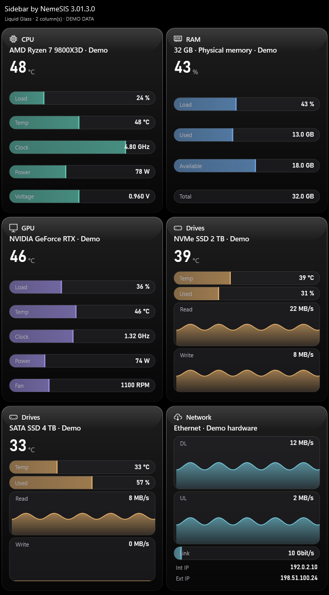</a>

All images are rendered by the app's own WPF renderer with demo hardware and simulated readings; they are not live benchmarks. Layout, colors, text sizes and columns are all adjustable.

## New in v3.01

- **Glass family:** six new layouts. Each reading sits in a glass capsule filled to its level; download/upload and drive read/write show a live 60-second trace, and the link capsule shows how much of the link is in use.
- **Temperature first:** CPU, GPU and drives lead with their temperature in the glass layouts, like in every other design.
- **Precise readings:** voltages, clocks, memory sizes and link speeds keep their decimals (1.350 V, 1.91 GHz, 13.9 GB, 2.5 Gbit/s).
- **Five color themes:** Catppuccin Mocha, Tokyo Night, Rosé Pine, Kanagawa and Everforest.
- **Reset on every settings page:** one button per page, confirmed with a second click.

<table>
<tr><th>Liquid Glass</th><th>Frost Glass</th><th>Aqua Glass</th></tr>
<tr>
<td><a href="Previews/LiquidGlass-1Column.png">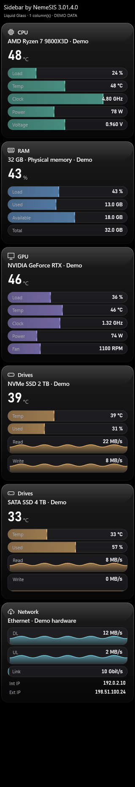</a></td>
<td><a href="Previews/FrostGlass-1Column.png">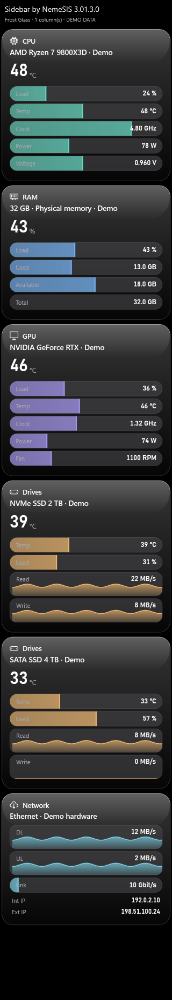</a></td>
<td><a href="Previews/AquaGlass-1Column.png">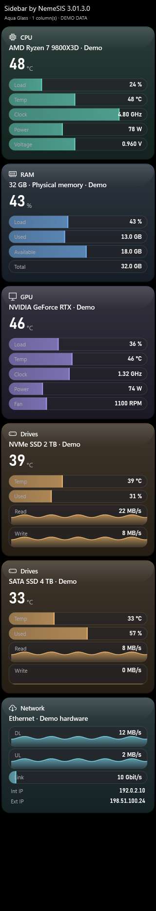</a></td>
</tr>
<tr><th>Prism Glass</th><th>Smoke Glass</th><th>Glass Tubes</th></tr>
<tr>
<td><a href="Previews/PrismGlass-1Column.png">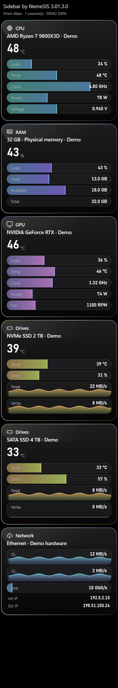</a></td>
<td><a href="Previews/SmokeGlass-1Column.png">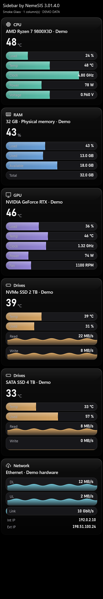</a></td>
<td><a href="Previews/GlassTubes-1Column.png">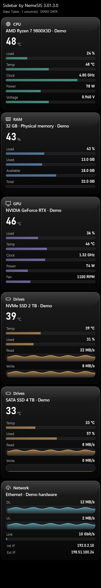</a></td>
</tr>
</table>

## All 97 layouts

Every layout with the same demo CPU, GPU and network card in the OLED Black theme. Open a group to see its layouts; click an image for full size.

<b>Glass</b> · 6 layouts · Glass slabs with a lit rim; readings in capsules filled like liquid, live traces for throughput.

 

<table>
<tr><td align="center" valign="top"><a href="Previews/Gallery/LiquidGlass.png">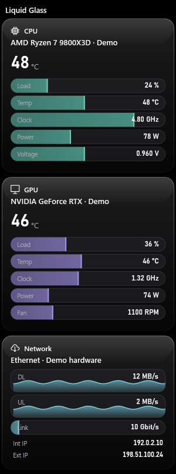</a> Liquid Glass</td><td align="center" valign="top"><a href="Previews/Gallery/FrostGlass.png">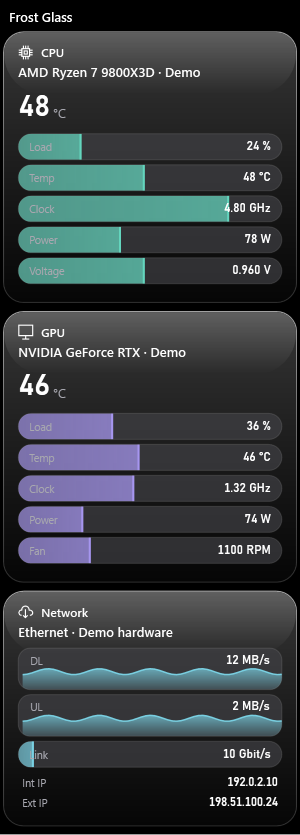</a> Frost Glass</td><td align="center" valign="top"><a href="Previews/Gallery/AquaGlass.png">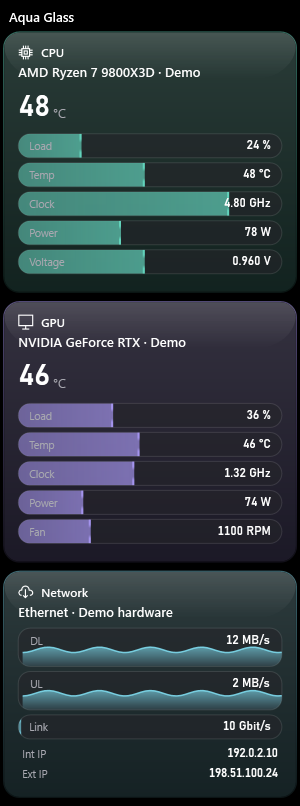</a> Aqua Glass</td><td align="center" valign="top"><a href="Previews/Gallery/PrismGlass.png">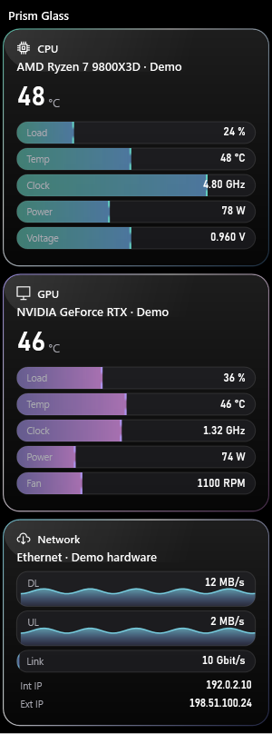</a> Prism Glass</td></tr>
<tr><td align="center" valign="top"><a href="Previews/Gallery/SmokeGlass.png">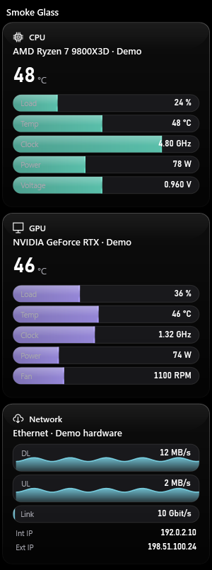</a> Smoke Glass</td><td align="center" valign="top"><a href="Previews/Gallery/GlassTubes.png">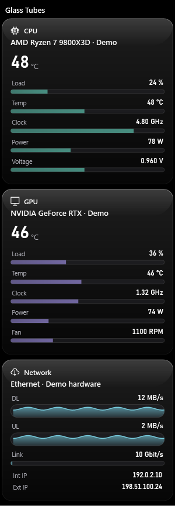</a> Glass Tubes</td></tr>
</table>

<b>Violet</b> · 9 layouts · Black reference cards with violet and magenta instruments.

 

<table>
<tr><td align="center" valign="top"><a href="Previews/Gallery/VioletMonitor.png">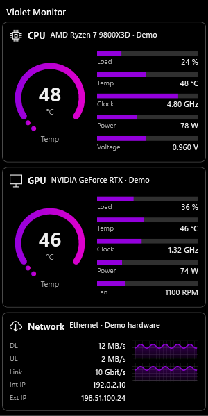</a> Violet Monitor</td><td align="center" valign="top"><a href="Previews/Gallery/VioletStack.png">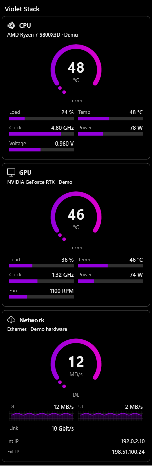</a> Violet Stack</td><td align="center" valign="top"><a href="Previews/Gallery/VioletMirror.png">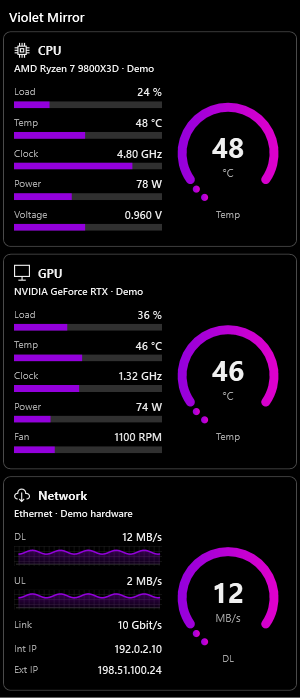</a> Violet Mirror</td><td align="center" valign="top"><a href="Previews/Gallery/VioletTwin.png">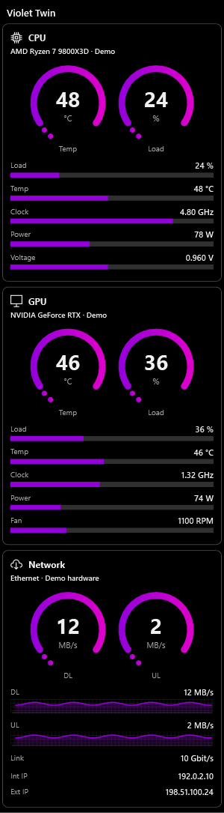</a> Violet Twin</td></tr>
<tr><td align="center" valign="top"><a href="Previews/Gallery/VioletTiles.png">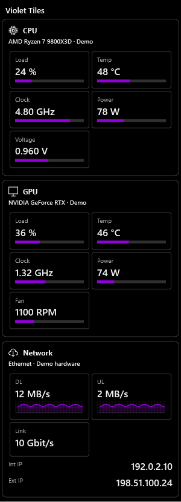</a> Violet Tiles</td><td align="center" valign="top"><a href="Previews/Gallery/VioletConsole.png">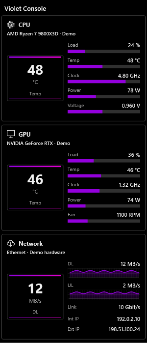</a> Violet Console</td><td align="center" valign="top"><a href="Previews/Gallery/VioletCrown.png">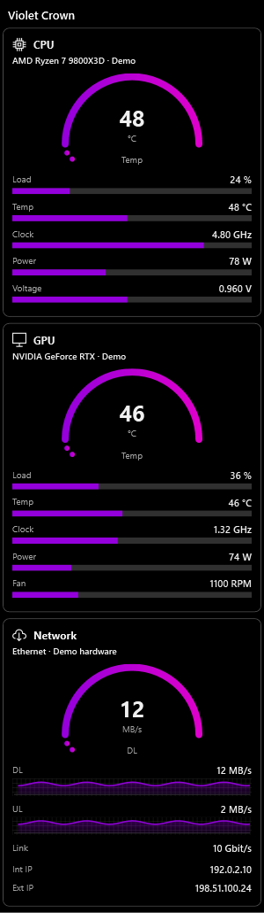</a> Violet Crown</td><td align="center" valign="top"><a href="Previews/Gallery/VioletRibbon.png">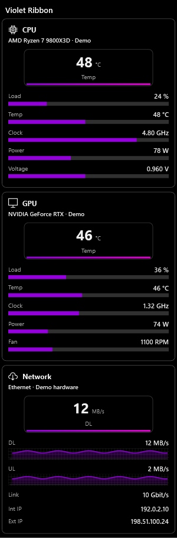</a> Violet Ribbon</td></tr>
<tr><td align="center" valign="top"><a href="Previews/Gallery/VioletCompact.png">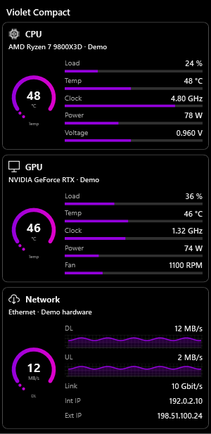</a> Violet Compact</td></tr>
</table>

<b>Classic and compact</b> · 13 layouts · Lists, tables and dense rows.

 

<table>
<tr><td align="center" valign="top"><a href="Previews/Gallery/Original.png">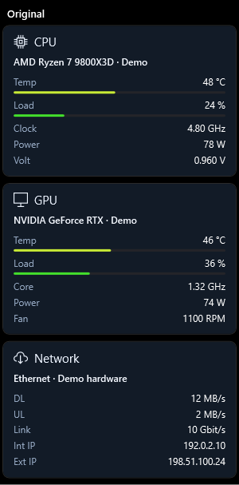</a> Original</td><td align="center" valign="top"><a href="Previews/Gallery/Modern.png">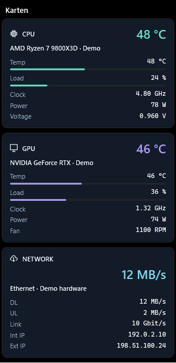</a> Karten</td><td align="center" valign="top"><a href="Previews/Gallery/Compact.png">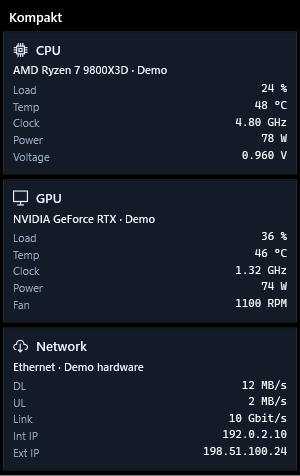</a> Kompakt</td><td align="center" valign="top"><a href="Previews/Gallery/Dashboard.png">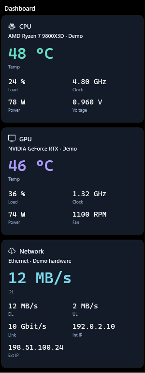</a> Dashboard</td></tr>
<tr><td align="center" valign="top"><a href="Previews/Gallery/Text.png">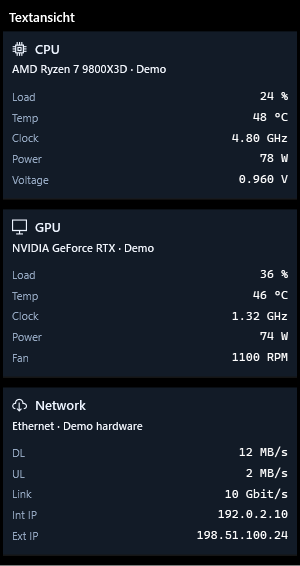</a> Textansicht</td><td align="center" valign="top"><a href="Previews/Gallery/Tiles.png">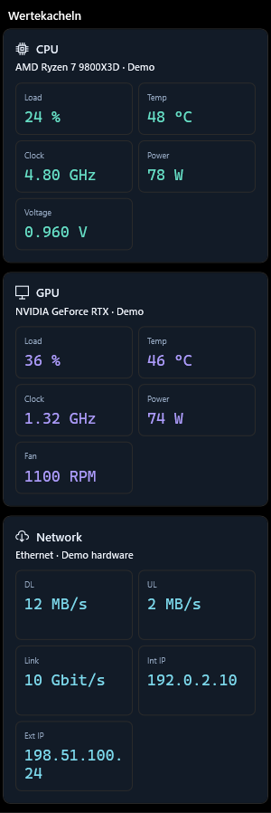</a> Wertekacheln</td><td align="center" valign="top"><a href="Previews/Gallery/Bars.png">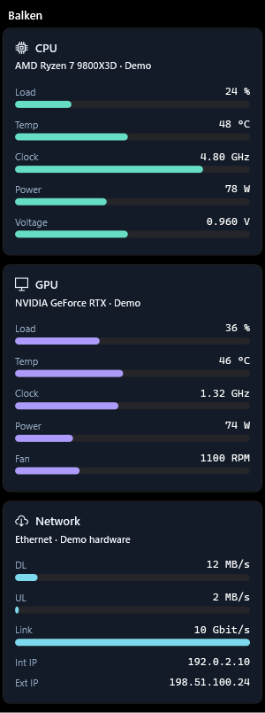</a> Balken</td><td align="center" valign="top"><a href="Previews/Gallery/Nano.png">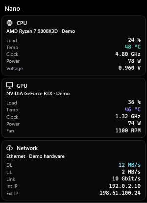</a> Nano</td></tr>
<tr><td align="center" valign="top"><a href="Previews/Gallery/EdgeCompact.png">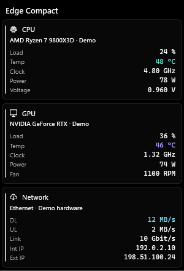</a> Edge Compact</td><td align="center" valign="top"><a href="Previews/Gallery/FlowCompact.png">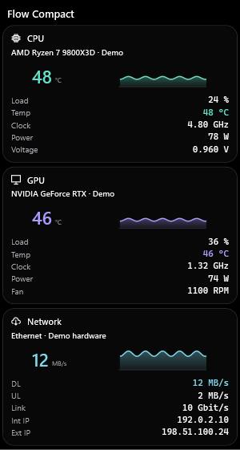</a> Flow Compact</td><td align="center" valign="top"><a href="Previews/Gallery/OrbitMini.png">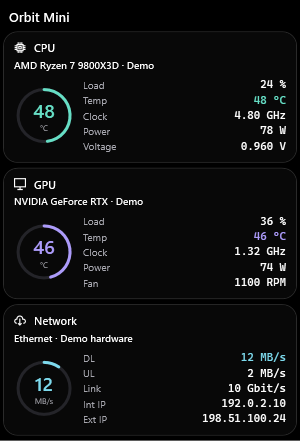</a> Orbit Mini</td><td align="center" valign="top"><a href="Previews/Gallery/TypeStack.png">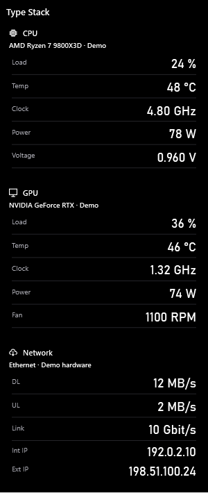</a> Type Stack</td></tr>
<tr><td align="center" valign="top"><a href="Previews/Gallery/ValueRail.png">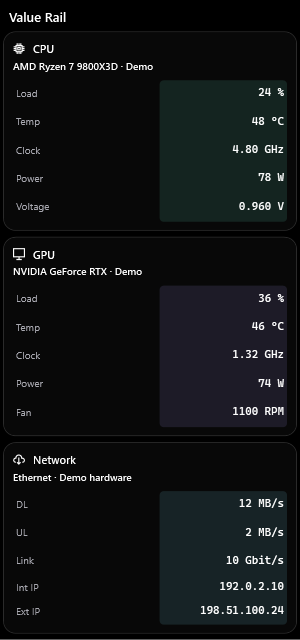</a> Value Rail</td></tr>
</table>

<b>Instruments</b> · 17 layouts · Round gauges, scales and digital displays.

 

<table>
<tr><td align="center" valign="top"><a href="Previews/Gallery/Gauges.png">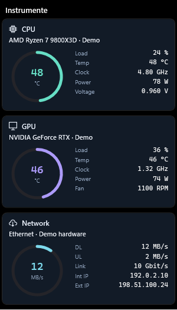</a> Instrumente</td><td align="center" valign="top"><a href="Previews/Gallery/OrbitGauge.png">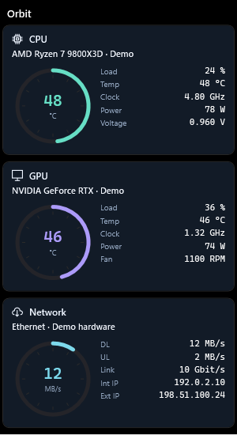</a> Orbit</td><td align="center" valign="top"><a href="Previews/Gallery/TwinRings.png">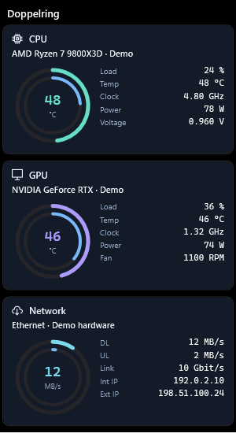</a> Doppelring</td><td align="center" valign="top"><a href="Previews/Gallery/ArcGauge.png">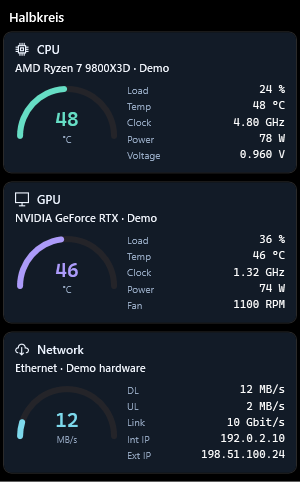</a> Halbkreis</td></tr>
<tr><td align="center" valign="top"><a href="Previews/Gallery/SegmentGauge.png">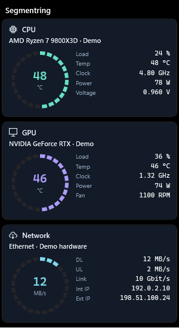</a> Segmentring</td><td align="center" valign="top"><a href="Previews/Gallery/SpeedGauge.png">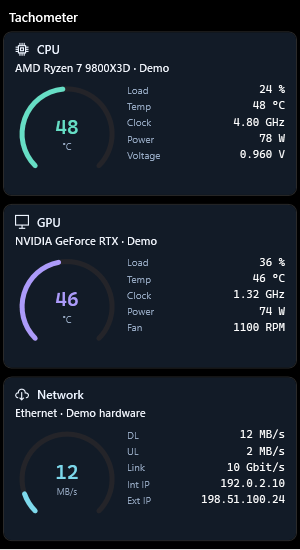</a> Tachometer</td><td align="center" valign="top"><a href="Previews/Gallery/ColumnGauge.png">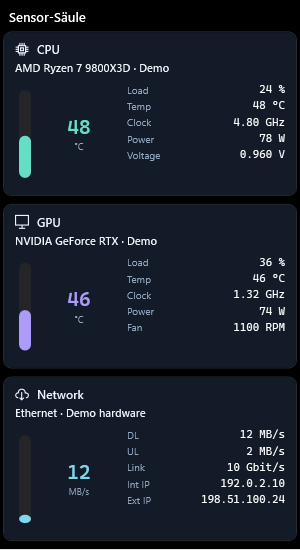</a> Sensor-Säule</td><td align="center" valign="top"><a href="Previews/Gallery/HorseshoeGauge.png">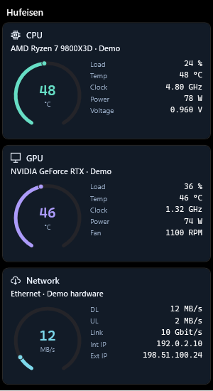</a> Hufeisen</td></tr>
<tr><td align="center" valign="top"><a href="Previews/Gallery/HexCore.png">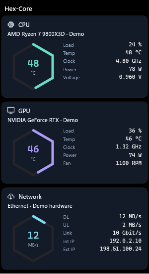</a> Hex-Core</td><td align="center" valign="top"><a href="Previews/Gallery/Console.png">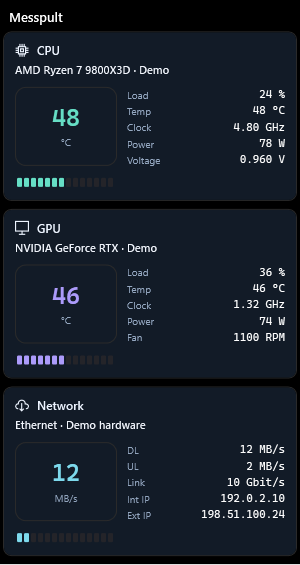</a> Messpult</td><td align="center" valign="top"><a href="Previews/Gallery/Digital.png">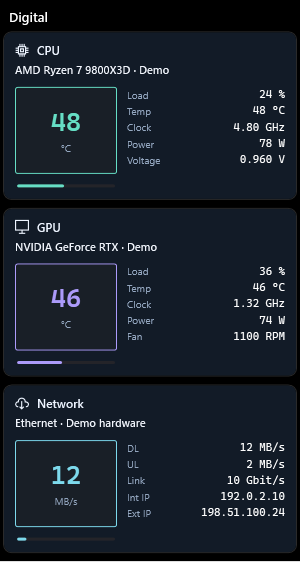</a> Digital</td><td align="center" valign="top"><a href="Previews/Gallery/SideRail.png">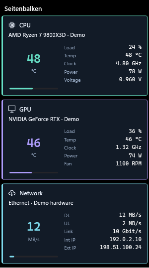</a> Seitenbalken</td></tr>
<tr><td align="center" valign="top"><a href="Previews/Gallery/DotMatrix.png">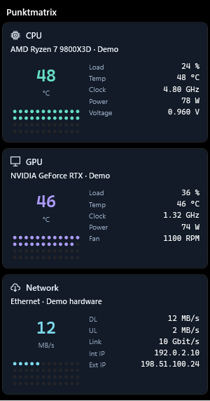</a> Punktmatrix</td><td align="center" valign="top"><a href="Previews/Gallery/Panorama.png">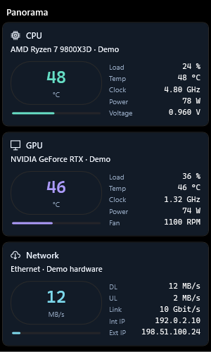</a> Panorama</td><td align="center" valign="top"><a href="Previews/Gallery/Tape.png">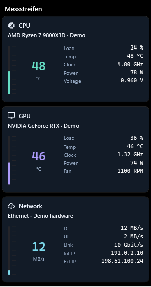</a> Messstreifen</td><td align="center" valign="top"> Bitfield</td></tr>
<tr><td align="center" valign="top"> Rackmount</td></tr>
</table>

<b>Fluent and studio</b> · 13 layouts · Soft Windows-style surfaces and calm typography.

 

<table>
<tr><td align="center" valign="top"> Fluent</td><td align="center" valign="top"> Glass</td><td align="center" valign="top"> Precision</td><td align="center" valign="top"> Neon Edge</td></tr>
<tr><td align="center" valign="top"> Orbit Studio</td><td align="center" valign="top"> Fluent UI</td><td align="center" valign="top"> Fluent UI Compact</td><td align="center" valign="top"> Fluent UI Hero</td></tr>
<tr><td align="center" valign="top"> Widget Board</td><td align="center" valign="top"> Command Center</td><td align="center" valign="top"> Fluent Glass</td><td align="center" valign="top"> Telemetry</td></tr>
<tr><td align="center" valign="top"> Minimal Pro</td></tr>
</table>

<b>Live history</b> · 11 layouts · Real 60-second history curves.

 

<table>
<tr><td align="center" valign="top"> Panoramic Flow</td><td align="center" valign="top"> Split Wave</td><td align="center" valign="top"> Signal Strip</td><td align="center" valign="top"> Dual Trace</td></tr>
<tr><td align="center" valign="top"> Floating Chart</td><td align="center" valign="top"> Telemetry Grid</td><td align="center" valign="top"> Widget Board Black</td><td align="center" valign="top"> Line Dashboard</td></tr>
<tr><td align="center" valign="top"> Waveform</td><td align="center" valign="top"> Dashboard Pro</td><td align="center" valign="top"> Focus</td></tr>
</table>

<b>Widgets and HUD</b> · 14 layouts · Bold panels, neon and system HUDs.

 

<table>
<tr><td align="center" valign="top"> Neon Panel</td><td align="center" valign="top"> Signal Deck</td><td align="center" valign="top"> Sensor Deck</td><td align="center" valign="top"> Redline</td></tr>
<tr><td align="center" valign="top"> Pulse Tiles</td><td align="center" valign="top"> Aurora Flow</td><td align="center" valign="top"> Contour</td><td align="center" valign="top"> Monochrome</td></tr>
<tr><td align="center" valign="top"> Titan HUD</td><td align="center" valign="top"> Cyber Pulse</td><td align="center" valign="top"> Performance HUD</td><td align="center" valign="top"> Glass Edge</td></tr>
<tr><td align="center" valign="top"> Vertical Rail</td><td align="center" valign="top"> Soft OLED</td></tr>
</table>

<b>Creative</b> · 14 layouts · Unusual arrangements of the same readings.

 

<table>
<tr><td align="center" valign="top"> Capsule Dock</td><td align="center" valign="top"> Honeycomb</td><td align="center" valign="top"> Flip Board</td><td align="center" valign="top"> Signal Fan</td></tr>
<tr><td align="center" valign="top"> Petal Matrix</td><td align="center" valign="top"> Ticket Rail</td><td align="center" valign="top"> Folded Sheet</td><td align="center" valign="top"> Label Dock</td></tr>
<tr><td align="center" valign="top"> Ladder Grid</td><td align="center" valign="top"> Metro Mosaic</td><td align="center" valign="top"> Sensor Map</td><td align="center" valign="top"> Split Panel</td></tr>
<tr><td align="center" valign="top"> Typographic</td><td align="center" valign="top"> Blueprint</td></tr>
</table>

## 19 color themes

The color theme is independent of the layout. Here every theme on the Liquid Glass CPU card:

<table>
<tr><td align="center" valign="top"> Original</td><td align="center" valign="top"> Midnight</td><td align="center" valign="top"> Graphite</td><td align="center" valign="top"> OLED Black</td><td align="center" valign="top"> Nord</td></tr>
<tr><td align="center" valign="top"> Dracula</td><td align="center" valign="top"> Gruvbox</td><td align="center" valign="top"> Solarized Dark</td><td align="center" valign="top"> Terminal</td><td align="center" valign="top"> Neon</td></tr>
<tr><td align="center" valign="top"> Compact</td><td align="center" valign="top"> Minimal</td><td align="center" valign="top"> Light</td><td align="center" valign="top"> Arctic</td><td align="center" valign="top"> Catppuccin Mocha</td></tr>
<tr><td align="center" valign="top"> Tokyo Night</td><td align="center" valign="top"> Rosé Pine</td><td align="center" valign="top"> Kanagawa</td><td align="center" valign="top"> Everforest</td></tr>
</table>

## Make it yours

**The previews are example configurations. Layout, text, colors and columns are customizable.**

| Area | What you can change |
| --- | --- |
| Layout and placement | 97 layouts; monitor; left/right/top/bottom placement; column width; 1–4 columns; fit-to-view or scrolling; readings beneath the instrument |
| Typography | Font family, general size, separate widget-title, hardware-name, label, reading, instrument-number and unit sizes; individual visibility |
| Hardware icons | Show/hide and size |
| Colors and graphics | Color theme, text/label/hardware-name/reading colors, category graph colors, secondary color, graph track, graphic size and thickness |
| Backgrounds | Widget background opacity while foreground text remains opaque |
| Content | Device visibility, selected readings, custom sensors on their matching widget, custom hardware names, card order and optional shared HW Sensors frame |
| Sensors and operation | Sensor source, CPU temperature source, °C/°F, refresh interval, warning thresholds, startup on/off, taskbar-edge reservation and tray behavior |
| Network | Selected adapter, DL/UL, link speed and optional internal/external IPs; IPs refresh only when you press the fetch button |

Available controls are shared across the designs; a layout without a main instrument or history chart has no such element to resize. The Sidebar uses English labels. Settings support German, English, French, Italian, Spanish and Portuguese.

## Settings

## Start and update

Download the EXE into a writable folder and close the previous instance before running it. .NET is included. To preserve your choices, keep `aurora-settings.json` beside the EXE. The actual EXE/configuration/startup paths are shown in System information. If you move or rename the EXE, review the startup target in Setup. Advanced sensor setup may require one administrator approval. The EXE is unsigned.

## Hardware and sensor support

Hardware and available sensors are detected on the computer running the EXE. The app does not reuse fixed sensor addresses from the developer PC. It supports many AMD Ryzen/X3D and Intel CPU systems, NVIDIA/AMD/Intel GPUs, storage devices, motherboard and cooling sensors through the bundled libraries. Exact readings depend on the model, BIOS/firmware, installed vendor drivers and access rights; not every sensor is exposed on every machine.

- **LibreHardwareMonitor + PawnIO** is the default source.
- **Open Hardware Monitor + PawnIO** is a hybrid option: a modified driverless OHM component supplies supported GPU/SMART data and Libre/PawnIO bridges CPU/motherboard and missing readings. It is not an entirely independent CPU sensor engine.
- RAM, volumes and network use Windows APIs. Advanced CPU/motherboard sensors need PawnIO and appropriate access; Setup provides status and installation/configuration actions. Setup may need administrator approval once.
- Missing readings display `—`; a stopped fan or idle load can correctly be zero. First sensor samples may need initialization time.
- No WinRing0 or InpOut driver is bundled. The existing driver/resource checks are rerun for this release.

The source includes synthetic mapping tests for Ryzen 5900X, 9800X3D and 9950X3D, Intel Core i7-14700K and Core Ultra 9 285K patterns, with NVIDIA, AMD Radeon and Intel Arc GPU patterns under both sources. These are simulated mapping profiles, **not physical tests or guarantees for every listed model**. Fresh physical testing was performed only on the available Ryzen 9 5900X / RTX 3080 / ASUS X570 system. See [VALIDATION.md](VALIDATION.md) for exact evidence and limits.

## Validation and source

The release workflow runs the data, sensor-mapping and native UI test suites on Windows before it publishes; its results are attached to the release as VALIDATION.txt. The v3.00 baseline passed 127,903 native UI checks, 181 data checks and 336 sensor fixture/safety checks. Short live testing was limited to the available Ryzen 9 5900X / RTX 3080 system. No universal hardware guarantee, reboot/sign-in test or long-duration soak is claimed.

The downloadable source ZIP matches the release project. Build with the .NET8 SDK using `./Build-Portable.ps1`. Runtime licensing notices are included in the portable bundle; source modifications and upstream licenses are in `THIRD-PARTY-NOTICES.txt`, `Licenses/` and `OpenHardwareMonitor.Driverless/`. No configuration files, private IP addresses or raw private recordings are part of the release. Automated GitHub publishing is explicit workflow-dispatch only; ordinary source uploads do not automatically publish an intermediate release.

The images in this README are produced by the "Render design previews" workflow, which renders them on Windows and commits them to `Previews/`.
